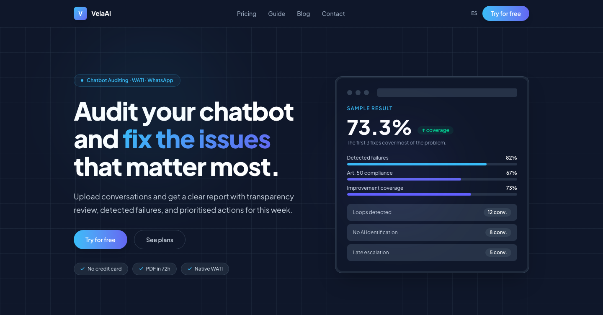
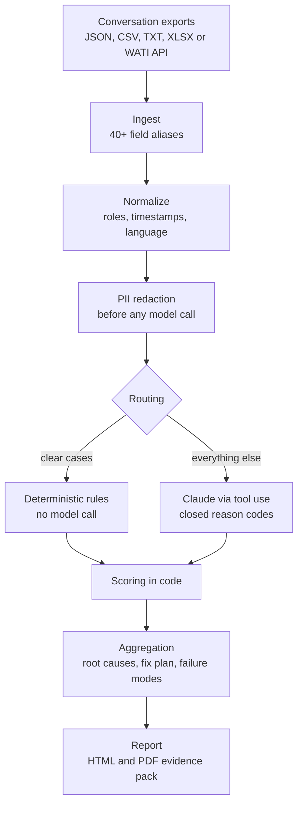
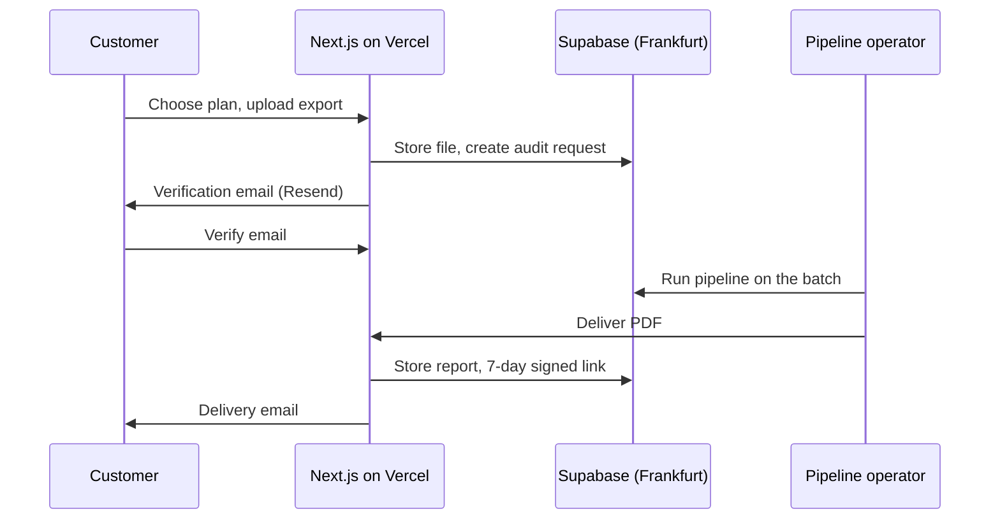
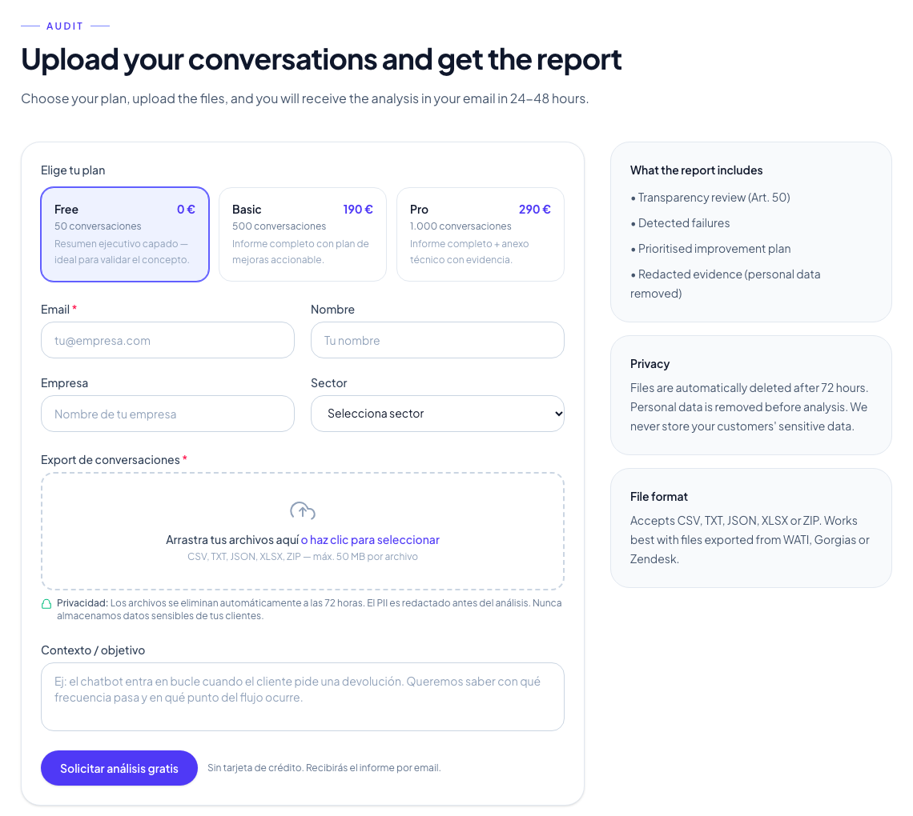

# VelaAI

VelaAI audits chatbot conversations against the transparency duty in Article 50 of the EU AI Act and checks conversation quality. A batch of conversations goes in; a report with the failures found, their root causes and a prioritised fix plan comes out.

I built it as founder, end to end, by directing AI coding agents. The code is private; this repository explains what the product does, how it is built and why I made the main decisions.

**Status:** working MVP. The pipeline runs end to end and the web intake is live at [velaai.io](https://velaai.io).

## The problem

From August 2026, Article 50 requires a chatbot to tell people they are talking to an AI. Most teams have thousands of chatbot conversations and no systematic way to know whether that happens, or where the bot is failing customers. Reading them by hand does not scale, and asking a model for free-text opinions gives answers you cannot compare between runs.

VelaAI puts structure around the model, so every result points to the message behind it and maps to a specific fix.

## How it works

Two independent parts: a Python batch pipeline that does the evaluation, and a Next.js web app that handles requests, files, payments and delivery.

Each conversation is evaluated on two dimensions:

- **Transparency (Art. 50):** did the bot identify itself as an AI in its first turn? Result: pass, weak, fail or not assessable, with one of 10 closed reason codes and the message that proves it.
- **Quality:** customer friction and repetition (exact repeats, loops, late or refused escalation), with one of 16 closed reason codes and the turns that show it.

### Web intake

Uploaded files are deleted after 72 hours and report links expire after 7 days. Paid plans use Stripe Payment Links with a webhook; promo codes are checked and consumed in one transaction so they cannot be used twice.

## Design decisions

| Decision | Why |
|---|---|
| The model fills a typed tool schema | It cannot answer in free text. Reason codes are closed enums, so the model cannot invent a category, and every code joins directly to a fix in a lookup table. |
| Scores are computed in code, after the model | The model returns a status; code turns it into a number. A model update can change a classification, but it cannot move how scores are calculated. |
| PII is redacted before any model call | Emails, phones and order IDs are removed before every model call by default. The original text stays in memory only to show evidence in the report. |
| Rules first, model when needed | A conversation with no disclosure at all fails without a model call. I also tested a cheaper triage model with escalation to a larger one; it is measured per batch, but client reports use the larger model on everything that the rules do not settle. |
| One evaluation per unique bot opening | Many bots open every conversation with the same message. The transparency check runs once per unique opening and the result is reused: in one test batch, 49 calls became 1. |
| Low confidence goes to a human | Conversations with low confidence or conflicting signals are flagged for manual review and shown as such in the report. |
| One analysis, several reports | The same aggregated result renders as a small-business report in Spanish, a one-page executive snapshot or a full evidence pack. |

## How I built it

I wrote the plan in 16 phases, from schemas and ingest to routing, reporting, internationalisation and an AI Act compliance register, and built each phase with AI coding agents (Claude Code). I owned the scope, the architecture, the evaluation design and the QA. The pipeline has 485 tests across 30 modules.

Before building, I talked with chatbot agencies and businesses to validate the problem, the offer and the pricing.

## Stack

Python 3.11, Pydantic, Anthropic Claude (tool use), Jinja2 and WeasyPrint · Next.js 16, TypeScript, Tailwind · Supabase (Postgres and Storage) · Resend · Stripe Payment Links · Vercel

## Contact

Ignacio Molina Casquero · [LinkedIn](https://linkedin.com/in/ignaciomolinacasquero) · imolinacasquero@gmail.com
